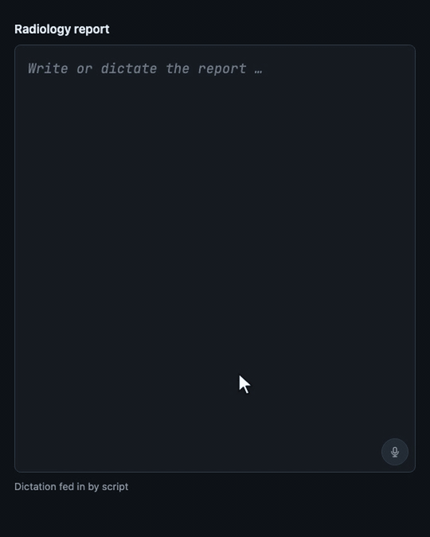

# termlight

An embeddable text field for radiology reports that recognises medical terms as you write and
highlights them typographically – the way a code editor highlights syntax. A web component
(`<med-editor>`) built on CodeMirror 6 and Lit, running entirely in the browser, in German,
English and French.

<p align="center">
  
</p>

<p align="center"><sub>Dictation fed in by a script; everything after the microphone is the real pipeline.</sub></p>

> **Technology demo.** Not a medical device, not intended for reporting and not for patient data.

## What it does

- **Recognises terms** locally in the browser: anatomy, imaging findings, diagnoses, medication,
  procedures. Negated terms ("no pleural effusion") get a colour of their own, suspected ones
  ("suspicious for") are marked.
- **Term card** for every term with definition, synonyms and codes.
- **Three languages** sharing the same concept ids; English terms that are common in German
  reports, such as "crazy paving", are recognised there too.
- **Optional services:** read-aloud and dictation through the browser's speech services, and a
  research panel in which a language model you run yourself answers only from named sources.

No backgrounds and no underlines: the highlighting works with typeface, weight, slope and colour.
There is no backend and no API key; without any configuration and without a network you still get
a working editor.

## Install

The package is not on npm yet. Install it from the repository:

```bash
npm install git+https://github.com/fhatje/termlight.git
```

You need a bundler (Vite, webpack, Rollup …): the package imports its font stylesheet and starts
the matcher in a Web Worker via `new URL(…, import.meta.url)`. Details in
[Embedding and customising](docs/embedding.md#install).

## Embed it

```html
<med-editor id="report"></med-editor>
```

```ts
import 'termlight';
import type { Annotation } from 'termlight';
import { createDictionaryRecognizer, createPackLookup } from 'termlight/providers/recognizers';

const packs = ['/packs/radiology.en.json'];   // exported as termlight/packs/*, served by you
const editor = document.querySelector('med-editor')!;
editor.config = {
  language: 'en',
  recognizers: [createDictionaryRecognizer({ packs, language: 'en' })],
  lookups: [createPackLookup({ packs })],
};
editor.addEventListener('annotations', (e) => console.log((e as CustomEvent<Annotation[]>).detail));
```

Fonts, colours and size are CSS custom properties on the element:

```css
med-editor {
  height: 70vh;
  --med-font-text: "IBM Plex Mono", monospace;   /* the text; load the font in your page */
  --med-font-size: 1rem;
  --med-finding: #0f6b3c;                        /* one colour per term type … */
  --med-finding-weight: 600;                     /* … and its weight, slope and family */
}
```

The `compact` attribute turns it into a plain text field without a toolbar that grows with its
content. Several editors can share one recognizer.

Every service sits behind a small interface (recognition, term details, speech, language model,
research sources), so each can be swapped or left out.

## Documentation

- [Embedding and customising](docs/embedding.md): installation, attributes, events and methods,
  every custom property with its default, dark mode, interface texts, what the element stores in
  the browser
- [Handbook](docs/handbook.md): service slots, languages, all backends, security, development

## Development

Requires Node 22.18 or newer.

```bash
npm install
npm run typecheck
npm test               # unit tests (vitest)
npm run build:lib      # writes lib/ (JavaScript and type declarations); runs before npm pack/publish
npm run build:seed     # rebuilds the dictionaries from tools/seed/*.txt
npm run build:lookup   # rebuilds the term-card files from Wikidata and Wikipedia (slow, resumable)
```

To add terms, enter them in `tools/seed/radiology.txt` (the format is described at the top of the
file) and run `npm run build:seed`.

## Data and licences

The code is released under the [MIT licence](LICENSE).

| Part | Licence |
| --- | --- |
| Dictionaries (`public/packs/*`) | CC0 |
| Term-card files (`public/lookup/*`) | Wikidata CC0; Wikipedia extracts CC BY-SA 4.0, each with its source link |
| JetBrains Mono (dependency) | SIL OFL 1.1 |
| CodeMirror, Lit (dependencies) | MIT, BSD-3-Clause |

The research panel is decision support and replaces neither the prescribing information nor
clinical judgement. Before any productive use, check the terms of the connected services, in
particular for automated retrieval from swissmedicinfo.
